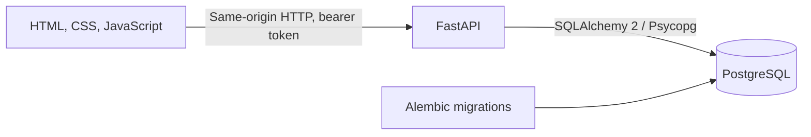

# Newtonite Operations Tracker

A team-based web app for creating and resolving operational work. It gives teams a shared, searchable queue, role-based actions, an approval workflow, and an activity history so ownership and decisions stay visible.

Built for the **Newtonite Software Engineering Challenge: Operations Under Pressure**. This repository implements a focused assessment-sized system; it is not intended as a production-ready enterprise service.

## Try the live demo

**Application:** [https://newtonite-ops-2300970100163.onrender.com](https://newtonite-ops-2300970100163.onrender.com)

**API documentation:** [https://newtonite-ops-2300970100163.onrender.com/docs](https://newtonite-ops-2300970100163.onrender.com/docs)

The demo runs on Render's free web service. It can take longer to answer after a period without traffic while the service wakes up. A cron-job.org check requests `/health` every 10 minutes to reduce idle spin-downs; this is a demo convenience, not an uptime guarantee.

### Demo accounts

These seeded accounts share one password: **`NewtoniteDemo2026!`**. They are public demo credentials, not private accounts. Do not reuse the password or put real information into this demo.

| Role | Email | Team |
| --- | --- | --- |
| Admin | `admin.ops@newtonite.local` | Operations |
| Lead | `lead.ops@newtonite.local` | Operations |
| Member | `member.ops@newtonite.local` | Operations |
| Viewer | `viewer.ops@newtonite.local` | Operations |
| Lead | `lead.eng@newtonite.local` | Engineering |
| Member | `member.eng@newtonite.local` | Engineering |
| Member | `member2.eng@newtonite.local` | Engineering |
| Lead | `lead.payments@newtonite.local` | Payments |
| Member | `member.payments@newtonite.local` | Payments |
| Viewer | `viewer.payments@newtonite.local` | Payments |

Newly registered accounts join the Operations team with the Member role. Signup is included as a demo convenience; the challenge itself did not require public registration.

### A short demo walkthrough

1. Sign in as `lead.ops@newtonite.local` and create an urgent Operations work item.
2. Open the item and assign it to a teammate, such as `Maya Operations Member`.
3. Sign in as `member.ops@newtonite.local`. Find the item under **Assigned to me**, add a comment, and move it to **In progress**, then **Awaiting approval**.
4. Sign in as the lead again and approve the item by moving it to **Resolved**. Only a Lead can perform this approval transition.
5. Open the activity timeline to see the item creation, assignment, comment, and state changes.

The local seeded accounts use the same credentials shown above. To create a clean local dataset, see [Reset local demo data](#reset-local-demo-data).

## What it does

- **Identity and access:** JWT sign-in, signup, and team membership with Viewer, Member, Lead, and Admin roles. The API checks permissions for every protected action; hiding a UI control is not the security boundary.
- **Team work queues:** Create, view, search, filter, and cursor-paginate work items by team, state, priority, assignee, and text.
- **Ownership:** Claim an unassigned item or assign/unassign it to an active teammate in the same team.
- **Workflow and approval:** Enforce allowed state transitions in the API. A Lead must approve work waiting for approval before it can become resolved.
- **History and collaboration:** Keep comments and important item changes in an activity timeline, including the actor and old/new values.
- **Concurrent edits:** Use atomic claims and version checks so conflicting actions fail clearly instead of silently overwriting one another.
- **Browser experience:** Plain HTML, CSS, and JavaScript served by FastAPI; team picker, work queues, forms, filters, details, and actionable errors.

## Technology

| Area | Technology | What it does here |
| --- | --- | --- |
| API | Python 3.12, FastAPI | HTTP routes, request validation, authentication dependencies, and OpenAPI docs |
| Browser | HTML, CSS, vanilla JavaScript | Same-origin interface without a separate frontend build system |
| Database | PostgreSQL 16 | Persistent users, teams, memberships, work items, and activity events |
| Data access | SQLAlchemy 2, Psycopg 3 | Typed ORM models and PostgreSQL queries |
| Schema changes | Alembic | Versioned database migrations |
| Passwords and tokens | pwdlib with Argon2, PyJWT | Password hashing and signed, expiring access tokens |
| Local environment | Docker Compose | Starts the API and PostgreSQL with one setup flow |
| Hosting | Render, Supabase Postgres | Container-hosted app and managed PostgreSQL for the live demo |
| Critical-behavior tests | pytest | Exercises concurrency, authorization, workflow, and history behavior |

## Run it locally

### Prerequisites

- Git
- Docker Desktop with Docker Compose enabled
- PowerShell (commands below are for Windows; adapt the copy command for another shell)

The easiest path is Docker Compose. It starts a local PostgreSQL container and the API, and keeps database files in the `postgres_data` named volume.

### Fresh setup

Run these commands in PowerShell:

```powershell
git clone https://github.com/Sahil-aka/newtonite-ops-2300970100163.git
cd newtonite-ops-2300970100163
Copy-Item .env.example .env
docker compose up --build -d
docker compose exec api alembic upgrade head
docker compose exec api python -m app.seed
```

Open the application at [http://localhost:8001](http://localhost:8001). The interactive API reference is at [http://localhost:8001/docs](http://localhost:8001/docs).

The seed command is safe to rerun. By default it creates three teams, ten demo users, and 3,000 deterministic sample work items so search and pagination can be demonstrated. To request a smaller sample:

```powershell
docker compose exec api python -m app.seed --items 100
```

### Useful local commands

```powershell
# See whether the API and database containers are running
docker compose ps

# Follow API logs
docker compose logs -f api

# Follow PostgreSQL logs
docker compose logs -f db

# Run the automated tests against the separate newtonite_test database
docker compose exec api pytest -q

# Stop the containers; keep the named database volume
docker compose down
```

If port `8001` is already in use, change the `api` port mapping in `compose.yaml` from `8001:8000` to `8002:8000`, then open `http://localhost:8002`.

### Reset local demo data

To delete the local PostgreSQL volume and all data in it, run:

```powershell
docker compose down -v
docker compose up --build -d
docker compose exec api alembic upgrade head
docker compose exec api python -m app.seed
```

`docker compose down -v` permanently removes the local Compose database volume. It does not delete the hosted Supabase database.

## Tests

Run the suite with:

```powershell
docker compose exec api pytest -q
```

The test fixture requires `TEST_DATABASE_URL` to point to a disposable PostgreSQL database named `newtonite_test`. Compose sets this variable to the local database container. The fixture verifies the database name before it creates and drops test tables, to protect the development database.

The current tests cover:

- Two simultaneous claims: only one request can claim an unassigned item.
- A stale edit: an update with an old version is rejected and the first change remains.
- Lead-only approval and activity recording for a successful transition.
- Cross-team item access denial.
- Invalid workflow transitions.
- Team-scoped assignment and activity recording.
- Rejection of assigning an item to a user outside its team.

## How the system fits together



The browser calls the API with `fetch`. The API validates request bodies, authenticates the bearer token, loads the current user, checks the user's team membership and role, performs a database transaction, and returns JSON. FastAPI also serves the static browser files from the same origin, so this project does not need a separate frontend host or CORS setup.

## API overview

Protected endpoints require `Authorization: Bearer <access-token>`. Use the **Authorize** control in Swagger UI after calling `POST /auth/login`.

| Method | Route | Purpose |
| --- | --- | --- |
| `POST` | `/auth/signup` | Create a Member account in Operations and return a token |
| `POST` | `/auth/login` | Exchange email/password for an access token |
| `GET` | `/auth/me` | Return the current authenticated user |
| `GET` | `/teams` | List the current user's teams and roles |
| `GET` | `/teams/{team_id}/members` | List members of a team the caller belongs to |
| `POST` | `/teams/{team_id}/items` | Create a work item in a team |
| `GET` | `/items` | List team items with filters and cursor pagination |
| `GET` | `/items/{item_id}` | Return item detail and recent activity |
| `POST` | `/items/{item_id}/claim` | Atomically claim an unassigned item |
| `POST` | `/items/{item_id}/assign` | Assign/unassign an item with a version check |
| `PATCH` | `/items/{item_id}` | Edit item fields using optimistic concurrency |
| `POST` | `/items/{item_id}/transition` | Request a permitted workflow transition |
| `POST` | `/items/{item_id}/comments` | Add a comment to item history |
| `GET` | `/health` | Liveness check for the API process |
| `GET` | `/health/ready` | Readiness check that runs `SELECT 1` against PostgreSQL |

## Important behavior and design

The state path is `open` → `in_progress` → `awaiting_approval` → `resolved` → `closed`. The API rejects disallowed jumps. A Lead is the only role allowed to approve `awaiting_approval` → `resolved`.

The list endpoint applies filters and pagination in PostgreSQL rather than downloading all work to the browser. Its cursor uses `(updated_at, id)` to give a stable order when timestamps match. An index supports common team/state, team/assignee, and team/priority queries. Search uses PostgreSQL `ILIKE`.

Each work item has a version. A client sends the expected version with an edit, assignment, or transition; the server updates only when that version is still current. The database update used for claiming succeeds only when the item is still unassigned. Conflicting requests receive `409 Conflict` and the browser can refresh to show current data. Activity events are written in the same transaction as the associated change.

## Deployment

The live demo is hosted at [https://newtonite-ops-2300970100163.onrender.com](https://newtonite-ops-2300970100163.onrender.com). The app runs as a Docker web service on Render and connects to PostgreSQL hosted by Supabase.

Render's service environment contains provider-managed values for `DATABASE_URL` and `JWT_SECRET`. Do not copy their real values into the repository, README, screenshots, or chat. `DATABASE_URL` must use SQLAlchemy's Psycopg URL form, `postgresql+psycopg://...`; the deployed Supabase connection uses the Session Pooler endpoint. The Docker production command applies Alembic migrations, seeds demo data, and starts Uvicorn on Render's supplied `PORT`.

The cron check is configured externally at cron-job.org to request `https://newtonite-ops-2300970100163.onrender.com/health` every 10 minutes. It is not application code. Free Render services may still restart or have limited availability, so do not describe the live demo as production-grade uptime.

## Known limitations

- Public signup places every new account into the Operations team as a Member. There is no invite flow, team selection, or membership administration.
- The Admin role currently has Member-level work-item permissions; no user/team administration API exists.
- There are no idempotency keys. The interface disables auth submit buttons while requests are pending, but repeated API create requests can still create duplicate work items.
- Notifications and other secondary jobs are out of scope, so there is no worker or transactional outbox.
- Activity detail returns at most the latest 50 events; there is no history pagination or retention policy.
- Search uses `ILIKE` without trigram/full-text indexes. Revisit it after measuring real search performance.
- Summary cards describe the currently loaded page, not totals across every matching database row.
- The browser has no automated end-to-end tests, refresh-token flow, or server-side token revocation.
- Public demo credentials are intentionally shared and are suitable only for this assessment demonstration.
- The Render free service can have cold starts, restarts, and resource limits.

## What I would improve next

1. Add idempotency keys for work-item creation and test duplicate retries.
2. Add browser-level tests for signup, login, role visibility, and conflict messages.
3. Add an invitation-based signup flow and explicit membership management.
4. Measure database query plans, then add full-text search or activity pagination where the data shows it is needed.
5. Add an outbox and worker if the product introduces notifications or other asynchronous side effects.

## Repository layout

```text
app/                     FastAPI application, routers, models, settings, and seed script
static/                  HTML, CSS, and vanilla JavaScript browser interface
alembic/                 Migration configuration and revisions
tests/                   Critical behavior tests
compose.yaml             Local PostgreSQL and API services
Dockerfile               Development and production container targets
ENGINEERING_DECISIONS.md Decision context, alternatives, trade-offs, and limitations
```
