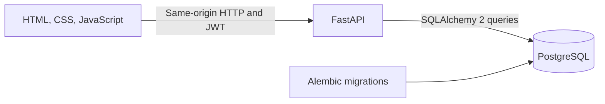

# Newtonite Operations Tracker

A team-based operations tracker built for the Newtonite Software Engineering Challenge. The browser interface supports JWT login, team queues, searchable work items, an approval workflow, comments, and an activity timeline.

## Current status

The FastAPI backend, PostgreSQL schema, and first browser UI slice are implemented. Hosted deployment setup remains to be completed. The API's interactive documentation is available at `/docs` while the service is running.

## Technology

- Python 3.12 and FastAPI
- PostgreSQL 16
- SQLAlchemy 2 and Alembic
- Pydantic Settings
- JWT access tokens (PyJWT); Argon2 password hashes (pwdlib)
- Docker Compose for local development
- pytest for critical workflow behavior tests

## Run locally with Docker

Prerequisites: Docker Desktop with Compose enabled.

In PowerShell, from the repository root:

```powershell
Copy-Item .env.example .env
docker compose up --build -d
docker compose exec api alembic upgrade head
docker compose exec api python -m app.seed
```

Open [http://localhost:8001](http://localhost:8001) for the website or [http://localhost:8001/docs](http://localhost:8001/docs) for API documentation. The API listens on port `8000` inside the container and is published at `8001` on the host. PostgreSQL is published at host port `5432` and stores data in the `postgres_data` Docker volume.

The seed command creates three teams, ten demo users, and 3,000 sample work items by default to make filtering and pagination easy to demonstrate. It can be rerun safely. For a different item count, use `docker compose exec api python -m app.seed --items 100`.

### Demo login

The seeded accounts share the demo password `NewtoniteDemo2026!`. These shared credentials are for local demonstration only. Do not use them in a public deployment.

| Role | Demo email | Team |
| --- | --- | --- |
| Admin | `admin.ops@newtonite.local` | Operations |
| Lead | `lead.ops@newtonite.local` | Operations |
| Member | `member.ops@newtonite.local` | Operations |
| Viewer | `viewer.ops@newtonite.local` | Operations |

Sign in on the website with a seeded email and password. The UI keeps the access token in browser session storage; the token lifetime is 60 minutes. You can also sign in through Swagger: run `POST /auth/login`, click **Authorize**, and enter the returned access token.

## Main API routes

All work item routes require `Authorization: Bearer <access-token>`.

| Route | Purpose |
| --- | --- |
| `POST /auth/login` | Exchange demo credentials for an access token |
| `GET /auth/me` | Return the authenticated user |
| `GET /teams` | List the current user's teams and roles |
| `GET /teams/{team_id}/members` | List active members of a team the caller belongs to |
| `POST /teams/{team_id}/items` | Create a work item for a team |
| `GET /items` | List accessible items; supports team, status, priority, assignee, text query, cursor, and limit filters |
| `GET /items/{item_id}` | Read an item with up to 50 latest activity events |
| `POST /items/{item_id}/claim` | Atomically claim an unassigned item |
| `POST /items/{item_id}/assign` | Assign or unassign an item with a version check; the assignee must belong to the same team |
| `PATCH /items/{item_id}` | Update item fields using an expected version |
| `POST /items/{item_id}/transition` | Move an item through an allowed workflow transition |
| `POST /items/{item_id}/comments` | Add a comment to the item's activity history |
| `GET /health` | Check that the API process is running |
| `GET /health/ready` | Check that the API can query PostgreSQL |

Workflow: `open` → `in_progress` → `awaiting_approval` → `resolved` → `closed`. Only a team Lead can approve an item from `awaiting_approval` to `resolved`. Viewers can read team data; members, leads, and admins can create, assign, or change work items and add comments. A user without membership receives `404` for team-scoped resources. The interface provides team selection, queue shortcuts, server-side search and filters, cursor-based "Load more," create, self-claim, assign/unassign to a teammate, edit, transition, approval, and activity/comment views.

## Architecture



## Database migrations

Apply schema changes with `docker compose exec api alembic upgrade head`. The initial migration is in `alembic/versions/`. Do not use `Base.metadata.create_all()` as a substitute for applying migrations to a deployment database.

## Tests

The tests use a separate PostgreSQL database named `newtonite_test`. The fixture refuses to run against another database name, creates that database if needed, and recreates its schema for the test session. It does not point at or clear the local development database.

```powershell
docker compose up --build -d
docker compose exec api pytest -q
```

The current suite covers simultaneous claims, stale version updates, Lead approval permissions, cross-team access, invalid workflow transitions, and team-scoped assignment with history.

## Known limitations

- The dashboard summary cards count the currently loaded page, not every matching row.
- Search uses PostgreSQL `ILIKE`; no trigram/full-text index is configured yet.
- The API does not implement idempotency keys for repeated create requests.
- Notifications, a transactional outbox, and background workers are intentionally out of scope.
- Browser behavior has not been covered by automated UI tests.
- Access tokens have no refresh or revocation flow; demo accounts share one password.
- Admin currently has the same work-item permissions as Member; there are no team/user administration endpoints.
- Render deployment configuration and a public demo URL are still pending.

## If I had another week

- Add idempotency keys for item creation and test retries.
- Add a transactional outbox only if notifications or other background work are introduced.
- Add browser-level tests for login, team permissions, assignment, and stale-edit messages.
- Add indexed text search and activity-history pagination after measuring query performance.

## Configuration and deployment notes

Environment variables are read from `.env` locally. `.env.example` shows the local defaults. For a hosted deployment, set `DATABASE_URL` to the provider's PostgreSQL connection string in SQLAlchemy's `postgresql+psycopg://` form and set `JWT_SECRET` to a long, randomly generated secret. The Dockerfile's final stage is `production`; Compose selects the `development` stage for local reload and test support.

Before publishing, replace demo credentials, use provider-managed secrets and database, apply Alembic migrations, and verify the production health endpoints. The frontend has not yet had automated browser coverage; Render deployment configuration remains to be completed.

### Keeping a free Render demo warm

The GitHub Actions workflow in `.github/workflows/render-keepalive.yml` requests the app's `/health` endpoint every five minutes. After deploying, add a repository Actions secret named `RENDER_HEALTH_URL` with the full URL, for example `https://your-service.onrender.com/health`. GitHub scheduled workflows can be delayed, so this may reduce cold starts but cannot guarantee that a free Render service never spins down. A paid Render web-service plan is the reliable option for avoiding idle spin-down.

## Repository layout

```text
app/                 FastAPI app, routers, models, settings, and seed script
static/              Browser interface (HTML, CSS, and JavaScript)
alembic/             Database migration configuration and revisions
tests/               Critical behavior tests
compose.yaml         Local PostgreSQL and API services
Dockerfile           Development and production container targets
ENGINEERING_DECISIONS.md  Design choices and tradeoffs
```
